# Forkget

[English](README.md) · 简体中文

为应用和智能体提供可随时丢弃的数据库工作区。



Forkget 可从 MySQL、PostgreSQL 或 MongoDB 的固定快照创建隔离分支。
你可以使用受支持的原生客户端连接，查看保留类型的变更，保存完整结果，
并在保留的基线上回放。分支具有明确的权限、行数预算和到期时间。

请从 [GitHub Releases](https://github.com/pterchan/ForkGet/releases) 选择版本，
并查看该版本的验收状态和已知限制。请使用可丢弃的非生产数据评估预发布版。
发布页会列出对应标签提供的源码、Linux x86_64 二进制文件、Console 和校验值。

由于并发外键完整性问题尚未解决，TiDB 不在 v0.1.1 的发布支持范围内。参阅[已知限制](doc/limitations.zh-CN.md)。

## 快速开始

1. [构建并运行本地部署](doc/install.zh-CN.md)。
2. [采集数据、运行应用并保存结果](doc/workflow.zh-CN.md)。
3. 使用[原生客户端或 SQLAlchemy](doc/connecting.zh-CN.md) 连接，或打开
   [Web Console](doc/console.zh-CN.md)。
4. 选择工作负载前，请阅读[支持范围](doc/support-matrix.zh-CN.md)、
   [限制](doc/limitations.zh-CN.md)和[安全指南](doc/security.zh-CN.md)。

```sh
forkget fork review-task --write
forkget status --id 42
# Wait until the branch is active, then connect and run your workload.
forkget diff --id 42 --output changes.json
forkget drop --id 42
```

将 `42` 替换为 `forkget fork` 返回的不可变分支 ID。

省略 `--write` 会创建只读分支。可写 SQL 分支会物化原生副本，准备时间和所需
空间随快照大小增加。MongoDB 的每个分支都需要独立客户端连接池。导出的结果工件
用于回放，完整备份需要另行保存。Forkget 不会自动把结果合并到生产数据源。

每套部署包含一个代理、一个控制服务、一个元数据 PostgreSQL 和一个独立配置的
原生服务引擎。源数据库和服务数据库应独立设置。随包提供的 Console 与控制服务
共用回环网络源，远程操作员通过认证的 SSH 隧道访问。数据库连接的两个数据链路
都需要验证 TLS。

## 运维与恢复

- [所有者和操作员命令](doc/cli.zh-CN.md)
- [部署配置和原生角色](deploy/README.zh-CN.md)
- [源数据库备份账号](doc/source-backup-roles.zh-CN.md)
- [结果保留与恢复](doc/recovery.zh-CN.md)
- [审计交付、协调升级和存储恢复](doc/audit-recovery.zh-CN.md)
- [存储与权限模型](doc/architecture.zh-CN.md)

## 贡献

源码构建方式和针对性检查见[贡献指南](CONTRIBUTING.zh-CN.md)。
[更新日志](CHANGELOG.zh-CN.md)记录用户可见的变更。Forkget 使用
[MIT 许可证](LICENSE)，依赖项和随包工具继续适用各自的许可证。

## 支持项目

[通过 PayPal 捐助](https://www.paypal.com/ncp/payment/E22SDNFKMNVJ6)。
捐款将全部用于支持 Forkget 和 Shift 的开发。
