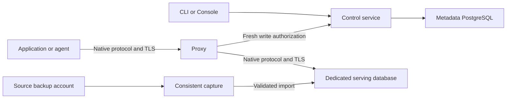

# Storage and permission model

A deployment contains one database proxy, a control service, metadata PostgreSQL
and one dedicated native serving engine. The source database is a separate input.
Applications use native protocol and TLS; owners use the loopback control API,
CLI or Console. Remote control uses an authenticated SSH tunnel.

## Pinned generations

An admitted snapshot has a catalog of logical tables, types, keys, defaults,
indexes and constraints. Unsupported objects are refused rather than silently
stripped. Import uses owned staging and preserves the previous active generation
on failure. A branch keeps its pinned generation when a new snapshot is imported.

A retained retiring generation can still serve its existing branches and eligible
replay. Once reclamation starts it accepts no new references. Retention and
native-copy slots are bounded; capacity errors report blockers instead of
silently evicting work.

## Permission is separate from storage

Access is read-only or read-write. Layout is a shared sparse baseline or a native
copy. New branches default to read-only; staging is always read-only. Legacy
MongoDB sparse branches can retain actual write access after migration. Inspect
reported access rather than treating an old mode label as permission.

Writable SQL branches materialize native copies and read those copies directly.
Read-only SQL branches share the pinned base. Newly created, known-empty branches
may use the base-only read strategy; existing branches with possible deltas keep
merged reads. MongoDB also supports document deltas. A separate MongoDB pool is
required for every branch.

## Writes and recovery

Only admitted operations reach native execution. Guarded SQL writes use native
transactions and a fresh authorization fence before commit. Direct-row budgets
accumulate within that transaction. Policy changes, grant revocation and expiry
invalidate its effective context. Grants do not revive a refused transaction.

SQL writes place a private witness in the same native transaction as business
changes. The metadata journal records durable intent and outcome delivery.
These are separate databases; a lost commit reply remains unknown until trusted
native evidence can prove a result. Delivery retries never repeat business DML.
MongoDB standalone keeps its actual partial and unknown semantics.

The witness is excluded from application reflection and result artifacts.
Cleanup waits for required durable facts and quiescence, and confirms native
commit before marking witness collection. Independent restore invalidates old
absence proofs and requires an explicit new storage incarnation.

See [audit and restore operations](audit-recovery.md), the
[application workflow](workflow.md) and [known limitations](limitations.md).
