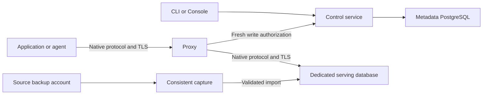

# 存储与权限模型

[English](architecture.md) · 简体中文

每套部署包含一个数据库代理、一个控制服务、一个元数据 PostgreSQL 实例和一个专用的原生服务引擎。源数据库作为独立输入。应用使用原生协议和 TLS，所有者使用监听在回环地址上的控制 API、CLI 或控制台。远程控制通过经过身份验证的 SSH 隧道进行。

## 分支固定的世代

通过准入检查的快照包含逻辑表、类型、键、默认值、索引和约束的目录。遇到不受支持的对象时，Forkget 会拒绝导入。导入使用由 Forkget 管理的暂存区，失败时保留此前的活动世代。导入新快照后，分支继续使用原先固定的世代。

处于退役阶段但仍保留的世代可继续为已有分支和符合条件的回放提供服务。回收开始后，该世代不再接受新的引用。世代保留数量和原生副本槽位都有上限。容量不足时会报告占用资源的对象，并保留现有工作。

## 访问权限与存储布局

访问权限可为只读或读写。存储布局可为共享的稀疏基线或原生副本。新建分支默认为只读，暂存分支始终只读。旧版 MongoDB 稀疏分支迁移后可能保留实际写入权限。应查看报告的访问权限，旧版模式标签不能单独作为判断依据。

可写 SQL 分支会创建原生副本，并直接从副本读取。只读 SQL 分支共享所固定的基线。新建且确定没有增量的分支可以采用仅读基线的策略。已有分支可能包含增量，因此继续使用合并读取。MongoDB 还支持文档增量，每个分支都需要独立的 MongoDB 连接池。

## 写入与恢复

只有通过准入检查的操作才会提交给原生引擎执行。受保护的 SQL 写入使用原生事务，并在提交前重新校验授权。直接影响的行数在该事务内累计计入预算。策略变更、授权撤销和到期都会使当前生效的授权上下文失效。已有事务被拒绝后，授予权限也无法使其恢复。

SQL 写入会在业务变更所在的原生事务中写入私有提交见证。元数据日志持久记录写入意图和结果投递情况。两者所在的数据库彼此独立。提交响应丢失后，结果保持未知，直到可信的原生证据能够证实结果。重试投递时不会再次执行业务 DML。MongoDB 单机模式保留其原有语义，操作可能部分生效，结果也可能未知。

应用反射和结果工件均不包含提交见证。清理会等待所需事实持久化且相关操作停止，并在确认原生提交后才标记见证已回收。独立还原会使旧的缺失证明失效，之后必须显式登记新的存储实例标识。

参阅[审计和还原操作](audit-recovery.zh-CN.md)、[应用工作流](workflow.zh-CN.md)和[已知限制](limitations.zh-CN.md)。
